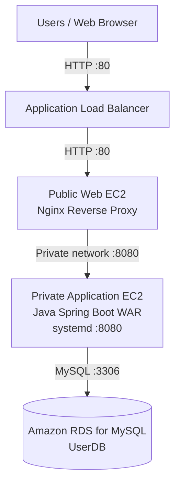

# Nexora — Java Web Application on AWS 3-Tier Architecture

A Java-based web application deployed on AWS using a three-tier architecture with an Application Load Balancer, Nginx, a private application server, and Amazon RDS for MySQL.

## Table of Contents

- [Project Overview](#project-overview)
- [Architecture Overview](#architecture-overview)
- [AWS Services Used](#aws-services-used)
- [Project Structure](#project-structure)
- [Prerequisites](#prerequisites)
- [Infrastructure and Networking](#infrastructure-and-networking)
- [Application Deployment](#application-deployment)
- [Database Configuration](#database-configuration)
- [Security Best Practices](#security-best-practices)
- [Monitoring and Maintenance](#monitoring-and-maintenance)
- [Troubleshooting](#troubleshooting)
- [Future Improvements](#future-improvements)
- [Contributing](#contributing)

---

## Project Overview

### Introduction

Nexora is a Java web application deployed on Amazon Web Services (AWS) using a three-tier architecture. The project demonstrates how a Java application can be hosted on EC2, exposed through a load-balanced web tier, and connected to a managed MySQL database.

The deployment separates the web, application, and database layers to improve organization, network isolation, and maintainability.

### Project Objectives

- Deploy a Java web application on AWS EC2.
- Configure Nginx as a reverse proxy.
- Use an Application Load Balancer to route incoming HTTP traffic.
- Run the Java application on a private EC2 instance.
- Connect the application to Amazon RDS for MySQL.
- Keep database credentials outside the application source code.
- Configure Linux services to manage the application process.
- Document security, troubleshooting, and operational procedures.

## Architecture Overview

### Three-Tier Architecture

**1. Web Tier**

- Amazon EC2 running Nginx.
- Receives traffic from the Application Load Balancer.
- Forwards application requests to the private application server.
- Uses a dedicated web security group.

**2. Application Tier**

- Private Amazon EC2 instance running the Java application.
- Spring Boot application packaged as a WAR file.
- Java application managed by `systemd`.
- Listens on port 8080.
- Connects to Amazon RDS for MySQL.

**3. Database Tier**

- Amazon RDS for MySQL.
- Database name: `UserDB`.
- Database endpoint is configured through environment-based application settings.
- Database access is restricted by security group rules.

### Architecture Diagram



### Request Flow

1. A user opens the application URL in a browser.
2. The Application Load Balancer receives the incoming request.
3. The load balancer forwards the request to the web EC2 instance.
4. Nginx proxies the request to the private Java application server.
5. The Java application processes the request and connects to RDS when database access is needed.
6. The response returns through the application server, Nginx, and load balancer to the user.

> **Architecture note:** This diagram represents the deployed request flow. The current setup uses a web EC2 instance and an application EC2 instance. Auto Scaling, multi-instance high availability, and Multi-AZ database failover are not claimed as implemented features.

## AWS Services Used

| Service | Purpose |
|---|---|
| Amazon EC2 | Hosts the Nginx web tier and Java application tier |
| Application Load Balancer | Routes incoming HTTP traffic to the web tier |
| Amazon VPC | Provides isolated networking for the deployment |
| Public and private subnets | Separate internet-facing and internal resources |
| Security Groups | Control traffic between the architecture layers |
| Amazon RDS for MySQL | Managed relational database |
| Amazon CloudWatch | Monitoring and operational visibility |
| Amazon SNS | Notification integration where configured |
| Nginx | Reverse proxy between the web and application tiers |
| Linux systemd | Starts and manages the Java application service |
| Git and GitHub | Version control and project documentation |

## Project Structure

```text
DevOps-Project-01/
├── README.md
├── PROJECT-GUIDE.md
├── .gitignore
├── CODE_OF_CONDUCT.md
├── CONTRIBUTING.md
├── SECURITY.md
├── docs/
│   └── AWS-3-Tier-Deployment.md
├── Java-Login-App/
└── Project-01-Java-Login-App/
    ├── pom.xml
    ├── Dockerfile
    ├── mvnw
    ├── mvnw.cmd
    ├── README.md
    └── src/
        ├── main/
        │   ├── java/
        │   ├── resources/
        │   └── webapp/
        └── test/
```

The `Project-01-Java-Login-App` directory contains the Java application source code. The `docs` directory contains additional AWS deployment documentation.

## Prerequisites

Before deploying the project, prepare the following:

- An AWS account with the necessary permissions.
- An EC2 key pair for SSH access.
- A configured VPC with public and private networking.
- An Application Load Balancer and target group.
- Linux EC2 instances with appropriate security groups.
- Amazon RDS for MySQL and a DB subnet group.
- Java 11-compatible runtime and Maven for building the application.
- Git for source code management.
- Nginx installed on the web instance.
- Database credentials supplied securely through environment variables.

### Local Development Environment

The application can be built from the project directory using Maven:

```powershell
cd D:\DevOps-Projects\DevOps-Project-01\Project-01-Java-Login-App
.\mvnw.cmd clean package
```

Review the build output and confirm that the WAR artifact is generated under the Maven `target` directory.

Do not commit build artifacts, local database credentials, private keys, or local Maven settings containing secrets.

## Infrastructure and Networking

### VPC and Subnets

The deployment separates resources according to their roles:

- The web tier accepts traffic forwarded by the Application Load Balancer.
- The application tier is accessed through private network connectivity.
- The database tier is not intended to be directly accessible from the public internet.

### Security Group Rules

Use security group references wherever possible instead of opening internal services to all IP addresses.

| Resource | Port | Allowed source |
|---|---:|---|
| Application Load Balancer | 80 | Internet, if public HTTP access is intended |
| Web EC2 | 80 | Application Load Balancer security group |
| Web EC2 | 22 | Authorized administrator IP |
| Application EC2 | 8080 | Web EC2 security group |
| Application EC2 | 22 | Authorized administration path |
| RDS MySQL | 3306 | Application EC2 security group |

Configure SSH access according to the actual administration method. Do not expose application port 8080 or database port 3306 publicly.

For production use, configure HTTPS with an appropriate TLS certificate and redirect HTTP traffic to HTTPS.

## Application Deployment

### 1. Build the Application

From the Java project directory, run:

```powershell
.\mvnw.cmd clean package
```

Verify that the WAR file was created:

```powershell
Get-ChildItem .\target\*.war
```

Use the artifact produced by the build rather than manually renaming or modifying an unrelated WAR file.

### 2. Configure the Application

The application configuration uses environment-based settings for the database connection.

The following are example environment variable names:

```text
DB_URL
DB_USERNAME
DB_PASSWORD
```

Configure the actual values on the application server through an appropriately protected service environment file or a secrets-management solution.

Do not put real passwords in `application.properties`, Git commits, shell history, or screenshots.

### 3. Run the Application Service

The Java application is managed by the Linux `systemd` service named `java-login-app.service`.

Check the service status:

```bash
sudo systemctl status java-login-app.service --no-pager
```

Check whether the service is enabled at boot:

```bash
sudo systemctl is-enabled java-login-app.service
```

Restart the service after deploying a new application artifact:

```bash
sudo systemctl restart java-login-app.service
```

Review application logs when troubleshooting:

```bash
sudo journalctl -u java-login-app.service -n 100 --no-pager
```

### 4. Configure Nginx

Nginx runs on the web EC2 instance and forwards incoming application requests to the private application server.

The following is an illustrative reverse-proxy configuration. Replace the upstream address with the actual private application endpoint before using it.

```nginx
server {
    listen 80;
    server_name _;

    location / {
        proxy_pass http://10.0.143.3:8080;
        proxy_http_version 1.1;

        proxy_set_header Host $host;
        proxy_set_header X-Real-IP $remote_addr;
        proxy_set_header X-Forwarded-For $proxy_add_x_forwarded_for;
        proxy_set_header X-Forwarded-Proto $scheme;
    }
}
```

Validate the Nginx configuration before reloading:

```bash
sudo nginx -t
sudo systemctl reload nginx
```

The upstream IP above is an example based on the current deployment notes. Verify the application's private IP before applying the configuration.

### 5. Verify the Deployment

From the web EC2 instance, check connectivity to the application:

```bash
curl -I http://10.0.143.3:8080/
```

Check the web server:

```bash
sudo systemctl status nginx --no-pager
```

Then open the configured Application Load Balancer DNS name in a browser and test the application's login and navigation pages.

## Database Configuration

### Amazon RDS for MySQL

The application connects to the RDS database named `UserDB`.

Database connection settings should be supplied through protected environment variables rather than hardcoded in source files.

Example configuration format:

```properties
spring.datasource.url=${DB_URL}
spring.datasource.username=${DB_USERNAME}
spring.datasource.password=${DB_PASSWORD}
```

Use the property names that match the actual application configuration.

### Database Security

- Keep the RDS instance private where the deployment design permits.
- Allow MySQL connections only from the application tier.
- Use strong, unique database credentials.
- Prefer AWS Secrets Manager for managed credential storage and rotation.
- Enable encryption at rest and in transit where configured.
- Review backup retention and recovery requirements.
- Never publish database passwords or connection strings containing credentials.

The actual database schema and table names should be verified against the application's SQL queries and database initialization scripts before documenting them as requirements.

## Security Best Practices

### Network Security

- Restrict inbound access using security group references.
- Keep the application and database layers off direct public access paths.
- Restrict SSH to authorized administrator IP addresses or use AWS Systems Manager where supported.
- Use HTTPS for public application traffic.
- Review VPC Flow Logs and access rules when available.

### Application Security

- Keep credentials outside version control.
- Use parameterized SQL queries to reduce SQL injection risk.
- Validate and sanitize user input.
- Avoid exposing internal exceptions or database details to users.
- Apply operating system and application dependency updates.
- Run security scans as part of the development workflow.

### IAM Security

- Follow least-privilege permissions.
- Prefer EC2 IAM roles over long-lived access keys.
- Do not store AWS access keys in source files.
- Review permissions and unused resources regularly.

### Data Protection

- Configure RDS backups and test recovery procedures.
- Use encryption for sensitive data.
- Protect service environment files with restrictive file permissions.
- Never store plain-text passwords for user authentication; use a suitable password-hashing algorithm.

## Monitoring and Maintenance

### Application Service

Check the service state:

```bash
sudo systemctl is-active java-login-app.service
```

Review recent logs:

```bash
sudo journalctl -u java-login-app.service --since "30 minutes ago" --no-pager
```

### Nginx

Check the configuration:

```bash
sudo nginx -t
```

Inspect service status:

```bash
sudo systemctl status nginx --no-pager
```

### AWS Monitoring

Use Amazon CloudWatch to review the available EC2, load balancer, and RDS metrics.

Where configured, Amazon SNS can deliver notifications for alarms or operational events. Confirm that the relevant alarms, notification subscriptions, and delivery tests are working before relying on them.

### Cost Management

- Stop or remove temporary resources when they are no longer needed.
- Review EC2, RDS, load balancer, storage, and monitoring charges.
- Avoid leaving unused public IPv4 addresses and other billable resources allocated.
- Use AWS Budgets and billing alerts to monitor expenditure.

Do not terminate resources that are still required by the live deployment.

## Troubleshooting

### Application Is Not Responding

Check the Java service:

```bash
sudo systemctl status java-login-app.service --no-pager
sudo journalctl -u java-login-app.service -n 100 --no-pager
```

Verify that the application is listening on port 8080 and that its service environment variables are configured correctly.

### Nginx Returns a 502 Bad Gateway

Check the private application endpoint:

```bash
curl -I http://10.0.143.3:8080/
```

Review the Nginx configuration and logs:

```bash
sudo nginx -t
sudo tail -n 100 /var/log/nginx/error.log
```

Verify security group rules between the web and application instances.

### Database Connection Failure

Check the following:

- The RDS endpoint and database name are correct.
- The username and password are configured correctly.
- The RDS security group allows port 3306 from the application security group.
- The database is available.
- The application instance has network connectivity to the database endpoint.

Do not solve connectivity problems by opening the database to `0.0.0.0/0`.

### Load Balancer Health Check Failure

Review the target health status in the EC2 console. Confirm that the registered web instance is reachable on the configured health-check port and path, and that the web security group allows traffic from the load balancer.

## Future Improvements

Potential enhancements for a more resilient production deployment include:

- Deploy web and application instances across multiple Availability Zones.
- Introduce Auto Scaling Groups with suitable health checks.
- Configure HTTPS using AWS Certificate Manager.
- Evaluate AWS Secrets Manager for database credentials.
- Expand automated testing and CI/CD integration with Jenkins or GitHub Actions.
- Add security scanning with tools such as SonarQube and Trivy.
- Improve application and infrastructure monitoring with CloudWatch alarms.
- Evaluate infrastructure as code using Terraform.
- Add automated deployment and rollback procedures.

These are proposed improvements, not claims that the features are already implemented.

## Contributing

Contributions and improvements are welcome.

1. Fork the repository.
2. Create a feature branch.
3. Make and test your changes.
4. Commit your changes with a clear message.
5. Push your branch.
6. Open a pull request describing the changes.

Follow the repository's `CONTRIBUTING.md` and `CODE_OF_CONDUCT.md` files.

## Author

**Shree Priyanka V L**

- GitHub: [shreepriyankav](https://github.com/shreepriyankav)
- LinkedIn: [Shree Priyanka](https://linkedin.com/in/shree-priyanka-a163692b5/)

## License

Refer to the repository's license file for the applicable terms.
